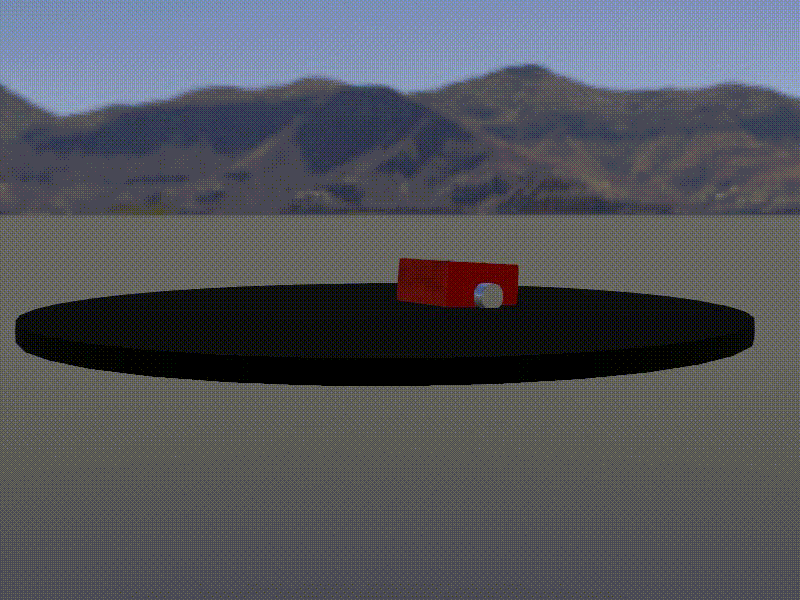

# 🤖 Odometria com Webots — minisumo cego

Material da aula de **odometria** da capacitação de robótica. Um minisumo **cego**
(sem nenhum sensor de distância) precisa ficar dentro do dohyo usando só a
odometria dos encoders das rodas, e o GPS do Webots serve para mostrar o quanto
a estimativa se afasta da realidade.

## 🤖 Demonstração Prática



## 🌿 Branches

| Branch | O que tem |
|---|---|
| `master` | Mundo + controller **esqueleto**, com os trechos da odometria em branco para completar
| `gabarito` | O mesmo projeto com o controller **completo e funcionando** 
| `Q-learning` | Projeto antigo de aprendizado reforçado(qlearning) no mesmo mundo 

## 📦 O que tem no projeto

```
.
├── worlds/
│   └── arena_sumo.wbt               # dohyo + robô com encoders e GPS
├── controllers/
│   └── minisumo_cego/
│       └── minisumo_cego.py         # controller do robô
└── readme.md
```

## 🛠️ 1. Instalar o Webots

Use a versão **R2025a** (a última estável quando este material foi feito).

**Ubuntu 22.04 / 24.04 (.deb):** baixe `webots_2025a_amd64.deb` em
<https://github.com/cyberbotics/webots/releases> e rode:

```bash
sudo apt install ./webots_2025a_amd64.deb
```

**Qualquer Linux com snap:**

```bash
sudo snap install webots
```

**Windows:** baixe e execute `webots-R2025a_setup.exe` na mesma página de releases.

## 📥 2. Clonar o repositório

```bash
git clone https://github.com/<SEU-USUARIO>/<NOME-DO-REPO>.git
cd <NOME-DO-REPO>
```

Para ver o gabarito:

```bash
git switch gabarito
```

## ▶️ 3. Rodar

Pelo terminal, de dentro da pasta do projeto:

```bash
webots worlds/arena_sumo.wbt
```

No Webots, o **editor de texto** fica ao lado da janela 3D. Abra
`minisumo_cego.py` nele, edite e reinicie a simulação para o robô rodar o código novo.

## 🧠 O que vamos fazer na aula

1. Ler os encoders e converter em distância por roda
2. Calcular quanto o centro do robô andou (`ds`) e girou (`dtheta`)
3. Atualizar a pose `(x, y, θ)`
4. Normalizar `θ`
5. Comparar a pose estimada com a posição real (GPS) e ver o erro crescer

## 📚 Referências

- [Calculating Wheel Odometry for a Differential Drive Robot](https://automaticaddison.com/calculating-wheel-odometry-for-a-differential-drive-robot/)
- [Princeton COS495, Lecture 5: Odometry](https://www.cs.princeton.edu/courses/archive/fall11/cos495/COS495-Lecture5-Odometry.pdf)
- [Harvey Mudd ARW, Lecture 01: Odometry Kinematics](https://www.hmc.edu/lair/ARW/ARW-Lecture01-Odometry.pdf)
- [Webots-Robot-Control-Tutorial](https://github.com/2black0/Webots-Robot-Control-Tutorial)
- [WK2 Webots Odometry (Univ. of Worcester)](https://colin-price.wbs.uni.worc.ac.uk/DifferentialDriveRobots/Worksheets/WK2_Webots_Odometry.pdf)
